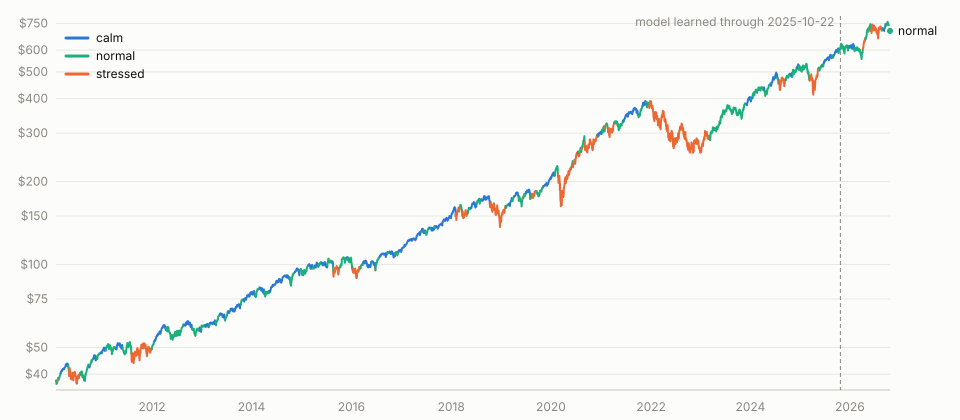

# MarkovQQQ: a hidden Markov model of QQQ regimes

How to train, test and run one hidden Markov model (HMM) on QQQ (the Nasdaq 100 ETF) so that every trading day you have a defensible answer to two questions:

1. **What regime is QQQ in as of the last completed session?**
2. **What is the regime distribution for the next trading session?**

This is not the `markov_*` strategy family described in `CorrectlyUsingMarkov.md`. That family has no hidden state: it buckets the 20-day return at ±5% and counts transitions between the buckets. Here the regime is never observed. It is inferred from returns and volatility.

## Status

Everything in this document is built and tested as of 2026-10-23. Commands were run against the real QQQ history; the output shown in section 4 is from that run.

| Step | What | Where |
|---|---|---|
| 1 | Backfill QQQ daily bars (2010 onward) | `backtestgosqlite` `daily_bars` |
| 2 | HMM math: fit, forward filter | `backtestgosqlite/pkg/hmm` |
| 3 | SQL input stage (return, realized volatility) | `sql/stages/hmm_inputs` |
| 4 | Train with a cutoff, write model tables | `train hmm` |
| 5 | Compare state counts, out-of-sample report | `train hmm compare`, `train hmm report` |
| 6 | Daily update with frozen parameters | `train hmm extend` (`ExtendHMM`) |
| 7 | Daily job | `trade_orchestrator` `regime_predict` (CLI, `/cron/regime_predict`, 17:00 ET Mon-Fri) |
| 8 | Bundle export and `/ready` check | `scripts/export_strategies.sh`, check `hmm_model` |
| 9 | Strategy family `hmm` and two QQQ strategies | `backtestgosqlite/pkg/hmm_strategy`, `sql/strategies/hmm_strategy`, section 6 |

Three things are not automated on purpose: **training** (a deliberate command, never part of the daily job or of `train all`), **deploying** the refreshed bundle (run `scripts/export_strategies.sh`, then `go mod vendor`, then deploy), and **trading** the regime (the two `hmm` strategies are not in `STRATEGY_ALLOWLIST`; section 6).

## 1. The data: QQQ daily bars  (BUILT)

The hourly market database holds only 503 daily QQQ bars (2024-10 to 2026-10), too few to fit a three-state model. The HMM reads a separate, long-history store instead:

```bash
cd /Users/darianhickman/Documents/trade_well/backtestgosqlite
go build -o ./bin ./cmd/daily_bars

./bin/daily_bars -dry-run          # downloads and reports; writes nothing
./bin/daily_bars                   # replaces QQQ's history in data/daily_bars.db
```

- Defaults: `-symbols QQQ`, `-start 2010-01-01`, `-db data/daily_bars.db`.
- Source: Yahoo daily bars (dividend- and split-adjusted `adj_close`). Each row records its `source`.
- It writes only `data/daily_bars.db`, table `daily_bar(symbol, date, close, adj_close, volume, source)`. The 19 GB hourly database is never touched.
- It keeps bars up to the last completed session only. A bar for a session still in progress is dropped, because it would change by the close.
- **Every run replaces the whole history.** An adjusted series is rescaled each time a dividend is paid, so merging old and new rows would put two different price scales in one series.

Check it (as of 2026-10-22: 4,227 bars, 2010-01-04 to 2026-10-22):

```bash
sqlite3 data/daily_bars.db "
  select count(*), min(date), max(date) from daily_bar where symbol='QQQ';
  select count(*) from (select adj_close a, lag(adj_close) over (order by date) p
                        from daily_bar where symbol='QQQ')
   where p is not null and abs(ln(a/p)) > 0.15;"      -- expect 0 moves over 15%
```

Note: Yahoo is an unofficial endpoint. It can change or throttle without notice.

## 2. The math

### 2.1 What the model observes each day

For each session *t*, from `adj_close` *P*:

- **Return:** `r_t = ln(P_t / P_{t-1})`
- **Realized volatility:** `v_t` = sample standard deviation of the 20 most recent returns, `r_{t-19} … r_t`
- **Observation vector:** `x_t = (r_t, v_t)`, so D = 2.

The first 20 sessions have no `v_t` and are dropped.

### 2.2 The model

There are N = 3 hidden states `S_t ∈ {0, 1, 2}`. The model has three parts:

- `π_i = P(S_1 = i)`: the initial distribution.
- `A_ij = P(S_{t+1} = j | S_t = i)`: the transition matrix. Each row sums to 1. The expected time in state *i* is `1 / (1 − A_ii)` sessions.
- Emissions: given `S_t = i`, `x_t ~ Normal(μ_i, Σ_i)` with a full 2×2 covariance, so return and volatility may be correlated within a regime.

Free parameters: `k = (N−1) + N(N−1) + N·D + N·D(D+1)/2 = 2 + 6 + 6 + 9 = 23`.

**State labels.** States are sorted by `μ_i[0]`, the mean return. State 0 is the lowest-mean-return regime ("bear"), state 2 the highest ("bull"), state 1 the middle. This makes labels stable across refits (otherwise EM may return the same regimes in a different order). It is a ranking by return only. Always read the fitted volatility of each state too: a "sideways" state with the highest volatility is a legitimate outcome.

### 2.3 Fitting: Baum-Welch (expectation-maximization)

`pkg/hmm` `Fit` runs EM on the training bars `x_1 … x_T`. Each iteration:

1. **Forward pass.** With emission likelihoods `b_t(i) = N(x_t; μ_i, Σ_i)`:
   - `α̃_1(i) ∝ π_i b_1(i)`
   - `α̃_t(j) ∝ b_t(j) · Σ_i α̃_{t-1}(i) A_ij`
   - Each row is normalised to sum to 1, with normaliser `c_t`. The log-likelihood is `LL = Σ_t ln c_t` (plus the density shift used to avoid underflow).
2. **Backward pass.** `β̃_T(i) = 1`, then `β̃_t(i) = Σ_j A_ij b_{t+1}(j) β̃_{t+1}(j) / c_{t+1}`.
3. **Posteriors.**
   - `γ_t(i) = α̃_t(i) β̃_t(i)`: probability of state *i* at *t* given **all** training bars.
   - `ξ_t(i,j) = α̃_t(i) A_ij b_{t+1}(j) β̃_{t+1}(j) / c_{t+1}`: probability of the transition *i→j* at *t*.
4. **Re-estimate.**
   - `π_i = γ_1(i)`
   - `A_ij = Σ_t ξ_t(i,j) / Σ_j Σ_t ξ_t(i,j)`
   - `μ_i = Σ_t γ_t(i) x_t / Σ_t γ_t(i)`
   - `Σ_i = Σ_t γ_t(i)(x_t − μ_i)(x_t − μ_i)ᵀ / Σ_t γ_t(i)`, plus a tiny diagonal floor (1e-9) so it stays invertible.
5. Stop when LL gains less than `Tol` (1e-6) or after 200 iterations.

EM only finds a local maximum, so `Fit` runs a deterministic quantile start (states initialised from return terciles) plus 4 seeded random restarts and keeps the highest LL. The same data and seed always give the same model.

Guards (the fit is refused, not silently weakened):
- fewer than `10 × k` bars (230 for N = 3, D = 2) in `pkg/hmm`, and fewer than `-min-bars` (default 1,000, about four years) in-sample sessions in `train hmm`;
- any non-finite observation;
- any state that owns under 2% of the bars (`ErrDegenerate`).

Model selection: `BIC = −2·LL + k·ln(T)`. Lower is better. Fit N = 2, 3, 4 on the same in-sample bars and compare. Keep N = 3 unless another N wins clearly and its states are interpretable and stable.

### 2.4 Sample splits

Reuse the holdout convention from the markov family and backtests: `storage.DefaultHoldoutMonths = 12`, and `storage.InSampleEnd` for the in-sample end date.

| Piece | Dates | What happens |
|---|---|---|
| In-sample (IS) | 2010-01-04 … `through` | EM learns `π, A, μ, Σ` from these bars only |
| Out-of-sample (OOS) | day after `through` … latest | parameters **frozen**; only filtering runs |
| Live | each new session | still frozen; one more filtering step |

`through` defaults to the newest bar minus 12 months. As of 2026-10-22 that is about 2025-10-22. The model must never see an OOS bar during fitting. If you retrain with a later `through`, the old OOS year becomes in-sample, and you no longer have an honest OOS result for it. Keep a record of which model produced which report.

### 2.5 Predicting: the forward filter, never the smoothed path

The prediction for day *t* is the **filtered** probability:

`p_t(i) = P(S_t = i | x_1 … x_t)`

It uses only observations up to and including day *t*. Two things must never be used for a live regime:
- the smoothed posterior `γ` or the Viterbi path from the fit. These use bars *after* *t*, so a label that looks right in a chart was not knowable that day. `pkg/study/hmm_regime.go` (the old prototype) used Viterbi over all history, which is why its results should not be trusted for trading.
- parameters refit on data including the day being predicted.

Two outputs per day:

- **Regime as of day t:** `p_t` (3 probabilities), and `regime_t = argmax_i p_t(i)`.
- **Next session:** `q_{t+1}(j) = Σ_i p_t(i) A_ij`, i.e. `q_{t+1} = p_t · A`. This is a prediction: it's a forecast of what regime tomorrow's bar will be, built from today's filtered state and the transition matrix.

`pkg/hmm` `Filter` returns both (`Probs` and `Next`). A unit test checks no look-ahead: appending later bars leaves every earlier row unchanged.

### 2.6 Daily update (frozen parameters)

The live job does **not** refit. Each day it:
1. refreshes QQQ daily bars to the last completed session,
2. recomputes `r_t`, `v_t` for the new bar,
3. reruns the filter over the full series with the saved `π, A, μ, Σ`,
4. writes the new `p_t` and `q_{t+1}`.

This mirrors `ExtendMarkov` in the markov family. A day-by-day filter over the whole series equals the full-history filter by construction, so there is nothing to drift.

**Timing.** Daily bars are final only after the close (4:00 pm ET). Run the job after the close, before the evening scan (18:00 ET). Row *t* is "regime as of the close of day *t*". It is usable for decisions on session *t+1*, never for day *t* itself.

### 2.7 When to retrain

Parameters are frozen between retrains, so they age. Retrain on a schedule you choose and write down (for example, yearly, or when a check below fails), not automatically in the daily job. A retrain sets a new `through`; compare the new model against the old on identical bars before replacing it (see 4).

## 3. Commands

All paths below are relative to `/Users/darianhickman/Documents/trade_well`. Build once:

```bash
cd backtestgosqlite
go build -o ./bin ./cmd/daily_bars ./cmd/train
```

Files: bars in `data/daily_bars.db`; model in `data/hmm_models.db` (override with `-bars-db` / `-model-db`; `APP_FOLDER` moves the whole `data/` folder). Both are git-ignored.

### 3.1 Test the math  (read-only)

```bash
cd backtestgosqlite
go test ./pkg/hmm ./pkg/dailybars ./pkg/train
```

The tests use seeded synthetic series with known regimes and a temp SQLite. They check: sorted labels; recovered means; probabilities summing to 1; no look-ahead; the SQL inputs against an independent Go calculation; that bars after `-through` never change the fit; and that **extending a model gives exactly the rows a full train with the same cutoff gives**.

### 3.2 Refresh the data

```bash
./bin/daily_bars -dry-run     # download and report, write nothing
./bin/daily_bars              # replace QQQ's history in data/daily_bars.db
```

### 3.3 Compare state counts  (read-only)

```bash
./bin/train hmm compare                  # 2, 3 and 4 states on the same in-sample sessions
./bin/train hmm compare -states 3,4,5,6
```

### 3.4 Train  (writes data/hmm_models.db)

```bash
./bin/train hmm -dry-run                 # fit and print, save nothing
./bin/train hmm                          # QQQ, 3 states, newest bar minus 12 months as the cutoff
./bin/train hmm -through 2025-10-22      # explicit cutoff (the in-sample end)
./bin/train hmm -states 3 -seed 1        # same data and seed always give the same model
```

Flags: `-symbols` (default QQQ), `-states` (2 to 6), `-through`, `-from`, `-holdout-months` (12), `-min-bars` (1000), `-seed`, `-calc-dir` (keep the SQL slice tables of the build for inspection), `-dry-run`. Training **replaces** the symbol's saved model and all its predictions. Sessions after `-through` are filtered with the frozen parameters and flagged `in_sample = 0`.

### 3.5 Out-of-sample report  (read-only)

```bash
./bin/train hmm report
```

### 3.6 Daily update  (writes data/hmm_models.db)

```bash
./bin/daily_bars                         # 1. refresh the bars
./bin/train hmm extend -dry-run          # 2. preview: prints the regime and next-session odds
./bin/train hmm extend                   # 3. append predictions for the new sessions (no refit)
```

`extend` refuses a symbol with no saved model, and refuses if the bars now start on a different date than the model was fit from (a sign the history changed: retrain).

### 3.7 The deployed job  (trade_orchestrator)

```bash
cd trade_orchestrator
go build -o ./bin ./cmd/orchestrator
./bin/orchestrator regime_predict --dry-run   # downloads to a scratch folder; writes nothing
./bin/orchestrator regime_predict             # live: extends the model, saves to regime_prediction
```

It is also `GET /cron/regime_predict[?dry_run=1]`, scheduled 17:00 ET Mon-Fri in `deploy_gae/cron.yaml` and in `job_runs.Schedule`. It refreshes QQQ's bars itself, so it needs no `daily_bars` step. It **fails** (and records nothing) if the newest QQQ bar is older than the last completed session, rather than report an old regime as current. The first output line is what `job_runs` keeps:

```
OK regime_predict symbol=QQQ as_of=2026-10-22 regime=2 (98%) next=2 (94%) new_sessions=1 trained_through=2025-10-22
```

The App Engine instance's model file is ephemeral (it restarts from the bundled copy), so the durable answer is the `regime_prediction` table in the orchestrator database: one row per `symbol, as_of_date` with `regime`, `regime_prob`, `probs`, `next_regime`, `next_regime_prob`, `next_probs` (JSON arrays by state).

### 3.8 Retrain and redeploy

```bash
cd backtestgosqlite
./bin/daily_bars && ./bin/train hmm compare && ./bin/train hmm && ./bin/train hmm report

cd ../trade_orchestrator
scripts/export_strategies.sh      # re-exports the bundle, including data/hmm_models.db -> pkg/strategies/deploy/hmm_models.db
go mod vendor                     # then build, test and deploy as usual
```

`/ready` shows a `hmm_model` check: ok when the model is current; warn when it trails the last session (normal until 17:00 ET) or its parameters are over two years old; bad when the bundle has no QQQ model.

## 4. How to know it is working

Run `train hmm report` and check these on the held-out year. None prove the model will make money; they check that it describes the data honestly.

1. **Likelihood per bar.** OOS mean log-likelihood per bar should be close to in-sample. A big drop means the regimes shifted or the fit overfit.
2. **Regimes differ.** Per regime, OOS mean return and volatility should be ordered like the fitted `μ`. If regimes look the same OOS, the model has no signal.
3. **Persistence.** Observed average run length per regime should be near `1 / (1 − A_ii)`. A regime that flips daily means the emissions overlap and the labels are noise.
4. **Stability across refits.** Refit with `-through` a few months earlier or later; sorted `μ` and `A` should move only a little.
5. **Compare against a trivial rule** (price above its 200-day average) before using it for anything.

### Actual results (2026-10-23, QQQ, 3 states, learned 2010-02-02 to 2025-10-22, 3,956 sessions)

```
state  mean ret  mean vol   P(stay)   expected
0        -0.029%     1.990%    0.982    54.7d
1        +0.102%     0.666%    0.972    35.8d
2        +0.103%     1.090%    0.963    27.2d

sample          state  days   mean ret   mean vol   avg run   LL/bar
in-sample       0      985       +0.002%     1.980%     44.8d    5.928
in-sample       1      1453      +0.074%     0.664%     26.9d    8.630
in-sample       2      1518      +0.111%     1.084%     20.5d    8.095
out-of-sample   0      70        +0.116%     1.639%     35.0d    6.397
out-of-sample   1      34        -0.005%     0.827%     17.0d    8.171
out-of-sample   2      147       +0.052%     1.101%     29.4d    8.139
mean log-likelihood per bar, in-sample: 7.7518      out-of-sample: 7.6573
```

As of the close of 2026-10-22 the model says state 2 (98%), and 94% state 2 for the next session.

### Chart: QQQ colored by regime



Each stretch of the line takes the color of the regime the model judged QQQ to be in at that session's close (the forward-filtered call, using only data up to that day). Regimes are ranked by fitted volatility (calm 0.67%, normal 1.09%, stressed 1.99% a day), not by state number, so the colors stay put if the model is refit. The dashed line is where the model stopped learning (2025-10-22); later sessions were scored with frozen parameters. The stressed stretches line up with 2018 Q4, early 2020, 2022 and 2025.

An interactive version (hover for price, date and regime; All, 10Y, 5Y and 1Y ranges; table view; dark mode) is at [`backtestgosqlite/data/reports/qqq_hmm_regimes.html`](../backtestgosqlite/data/reports/qqq_hmm_regimes.html). Both charts were built once from `data/hmm_models.db` and `data/daily_bars.db` (read-only) with the data baked in, so they do not update themselves. After a retrain or a daily extend, rebuild them; there is no command for that yet.

What this says:
- **Check 1 passes**: OOS log-likelihood per bar (7.66) is close to in-sample (7.75).
- **The regimes are volatility regimes, not bull/bear.** State 0 is high volatility (about 2% a day) with roughly zero mean return, state 1 is calm (0.67%), state 2 is moderate (1.09%). States 1 and 2 have almost the same mean return (+0.102% and +0.103%). "State 0 = bear, 2 = bull" would be a misreading: read state 0 as "stressed", 1 as "calm", 2 as "normal".
- **Because the two upper states barely differ in mean return, sorting by return does not order them stably.** A refit could swap states 1 and 2. Ordering by mean volatility instead would be stable here. This is a design choice for you to make; nothing downstream depends on it yet (see 5).
- **Persistence (check 3)**: observed average runs (44.8, 26.9, 20.5 days in-sample) are shorter than the fitted expectations (54.7, 35.8, 27.2). Runs are broken by days where the filtered argmax briefly flips; reasonable, not alarming.
- **OOS sample is thin**: only 34 days in state 1 out of sample.
- **State count.** BIC improves at every step: 2 states −58,155; 3 −61,142; 4 −62,708; 5 −64,085; 6 −65,190. It never levels off. That is not evidence for more states: the overlapping volatility feature (section 5) inflates the likelihood, and a model that always prefers more states cannot choose one. N = 3 was chosen by the plan, not by BIC.

## 5. Known limitations and open items

- **Overlapping volatility.** `v_t` is a 20-day window, so consecutive values share 19 returns and are strongly autocorrelated. The HMM assumes observations are independent given the state. This overstates confidence in a regime. The alternative is a model on returns alone, or on `ln v_t`; compare by BIC and OOS likelihood before trusting the probabilities as calibrated.
- **Probabilities are model-based, not calibrated.** `p_t` is the model's belief under its own assumptions (Gaussian emissions, a fixed transition matrix). Fat tails (the 2020-03 crash, the 2025-04 drop) are not Gaussian.
- **Regimes are not stationary.** A model trained to 2025-10 has never seen the future's regimes.
- **Labels are return ranks, and the data says that is a weak ordering.** See 2.2 and the results in section 4: the fitted regimes differ by volatility, and the two upper states have the same mean return. The `hmm` strategies avoid the problem by finding the stressed state by volatility, so a swap on refit does not change their signals (tested). Anything else that reads the state numbers is still exposed. Ordering the stored states by volatility is still an open choice.
- **BIC does not pick a state count here.** See section 4.
- **Yahoo dependency.** The daily job downloads QQQ's whole history from an unofficial endpoint each run. If it fails the job fails (it does not publish a stale regime), and `check_health` reports the missed run. The instance keeps `daily_bars.db` and the extended model in ephemeral storage; only the `regime_prediction` row is durable.
- **Two strategies use the regime, and neither is live.** See section 6. They are not in `STRATEGY_ALLOWLIST`, and their backtests are a smoke test, not evidence of an edge.
- **Rule exception.** The EM fit is Go, not SQL slice tables, because Baum-Welch is iterative. The inputs (return, volatility) and the out-of-sample report are SQL stages (`hmm_inputs`, `hmm_report`), and results go to named tables.
- **Not a trade signal by itself.** `regime_predict` places and sizes nothing. Only an `hmm` strategy in the allowlist can trade the regime, and that is a deliberate live-trading change.

## 6. Trading the regime: the `hmm` strategy family  (BUILT)

A new row-backed strategy family, `hmm`, in `backtestgosqlite` (`pkg/hmm_strategy`, SQL in `sql/strategies/hmm_strategy`, table `hmm_strategy` in `refdata/strategies.db`). It only reads the model that `train hmm` saved; it never trains or refits.

### 6.1 The rows

`hmm_symbol` is a field of the row and defaults to `QQQ` (the one model that exists); `trade_symbol` defaults to the same. Other columns: `rule`, `stress_prob`, `hold_days`, `take_profit_pct`, `stop_loss_pct`, `allocation_pct`, `cash_yield`, `slippage_pct`.

| id | rule | hold | stop | What it does |
|---|---|---|---|---|
| `hmm-calm-qqq` | `calm_filter` | 3 | 4% | Signal on every session whose filtered stressed-regime probability is under `stress_prob` (0.5). Position cap 1, so it re-checks every 3 sessions. |
| `hmm-calmdown-qqq` | `calm_down` | 10 | 5% | Signal only on the session the stressed probability falls back under 0.5 after a session at or over it. |
| `hmm-calm-soxl` | `calm_filter` | 3 | 12% | The QQQ model's calm rule traded on SOXL (`hmm_symbol` QQQ, `trade_symbol` SOXL). Stop is wider because SOXL moves about 3x as much. Chosen after the section 7 study, so it is not an independent pick. |
| `hmm-calm-tqqq` | `calm_filter` | 3 | 12% | The same rule on TQQQ (3x Nasdaq-100). Not deployed. |
| `hmm-normal-nrgu`, `hmm-normal-usd`, `hmm-normal-tecl` | `normal_filter` | 3 | 12%, 8%, 12% | Long while the middle volatility rank is the most likely regime (it ignores `stress_prob`), traded on NRGU (3x oil), USD (2x semiconductors) and TECL (3x technology). Not deployed. |

The exits are starting points, not tuned (gridsearch can vary hold, take-profit and stop from `strategy_family_param`).

### 6.2 Rules that matter

1. **The stressed regime is found by volatility, never by state number.** Stage `02_stress_state.sql` picks the state with the highest `mu_vol` in `hmm_params`. State numbers come from sorting by mean return, which is unstable between refits here. A test relabels the stored states and the signals do not change.
2. **Causal only.** The probability is the forward-filtered one for the session's close (`hmm_state_prob`), never the smoothed or Viterbi path.
3. **Entry is the next session's open** (`NextDayOpenEntry`), because the regime is known only at the signal session's close. Orders are market orders.
4. **A backtest only reads the model.** With no model it returns no signals, says to run `train hmm`, and creates nothing. A test confirms the model file is byte-identical after a run.
5. **Live scan.** `Prepare` downloads the symbol's daily bars and runs `ExtendHMM` with the parameters frozen at `trained_through` (the same way the out-of-sample backtest scores later sessions). Each instance does this itself, so the strategy does not depend on the instance's ephemeral model file or on the 17:00 `regime_predict` job.

Pipeline stages (one per file, slice tables): `01_schema`, `02_stress_state`, `03_stress_prob`, `04_stress_lag`, `05_generate_trades`, `06_trace` (the `signal_trace` rows a live scan shows beside ENTER or NO_SIGNAL).

### 6.3 Commands

```bash
cd backtestgosqlite
sqlite3 refdata/strategies.db < sql/seed/hmm_strategy.sql      # creates the table if needed and adds the two rows (done 2026-10-23)

# Backtest. -auto-download=false keeps it from downloading hourly bars into the market database.
./bin/backtest -strategy hmm-calm-qqq,hmm-calmdown-qqq -auto-download=false -start 2024-10-09
./bin/backtest -family hmm -auto-download=false -start 2024-10-09        # every hmm row

# Bundle the rows (the table travels with the others; -alloc 0.20 matches the bundle default)
cd ../trade_orchestrator && scripts/export_strategies.sh && go mod vendor
```

QQQ's hourly bars in the market database start 2024-10-09, so `-start` earlier than that adds nothing. The run does an in-sample pass (to the model's `trained_through`, 2025-10-22) and one held-out pass (2025-10-23 onward).

### 6.4 Results (2026-10-23, QQQ, 20% of equity per position)

| Strategy | In-sample return | Held-out return | Trades (in-sample / held-out) | Max drawdown (in / held-out) |
|---|---|---|---|---|
| `hmm-calm-qqq` | +5.20% (Sharpe 1.73) | +6.30% (Sharpe 2.18) | 55 / 44 | 2.34% / 1.79% |
| `hmm-calmdown-qqq` | +4.89% (Sharpe 7.89) | +5.47% (Sharpe 5.91) | 1 / 2 | 0.26% / 0.32% |

For scale, QQQ's own price rose about 22.8% over the in-sample window (493.17 to 605.38) and about 22.1% over the held-out one (610.60 to 745.55).

### 6.5 Findings

- **No evidence of an edge.** Returns include the 4.5% cash yield on the idle 80%, and no buy-and-hold QQQ row was run through the same simulator, so there is no like-for-like baseline. Do not read +5% against QQQ's +22%. A buy-and-hold row is the first thing to add.
- **`hmm-calmdown-qqq` is not testable on this window.** It made 1 trade in-sample and 2 held-out, and the reliability check flagged `WARN OVERFIT`. Its Sharpe is a few trades, not a result.
- **`hmm-calm-qqq` is mostly in the market** (103 idle days in-sample, 111 held-out of roughly 250 sessions), with small drawdowns. That is what a stressed-regime filter should do, but two years with few stress episodes cannot show whether it avoided any.
- **Thin history is the limit.** About two years of hourly QQQ, and the held-out year has 34 days in the calm state. Backfilling decades of hourly QQQ was ruled out, so a longer test needs the daily-bar simulation question (how to avoid same-day fills without ten times the data) answered first.
- **No regime exits live.** The backtest harness supports a signal that closes a position (`Entry` below zero), but `manage_exits` knows only take-profit, stop and hold days, and the live scan writes only LONG, BUY or ENTER signals. So a live position cannot be closed because the regime turned stressed. That is why `hmm-calm-qqq` uses a short hold and re-checks.

### 6.6 What is and is not done

- **Done and tested** (real SQLite, no mocks): signals equal an independent read of `hmm_state_prob` for both rules; `calm_down` fires only on crossings; state relabelling changes nothing; a missing model gives no signals and creates no file; the model is not modified; the row validator rejects bad symbols, rules, thresholds and sizes; `hmm_symbol` and `trade_symbol` default to QQQ; the family resolves a row by id; `signal_trace` agrees with the signals. Both repos pass `go build`, `go vet` and `go test`.
- **Not run:** the live `Prepare` path (the Yahoo download inside a scan), the real `scripts/export_strategies.sh`, a deployed scan. A scratch `strategy export` of the two rows worked.
- **Not done on purpose:** the strategies are not in `STRATEGY_ALLOWLIST`. To trade them, set it with `deploy_gae/config.sh set STRATEGY_ALLOWLIST=...` and deploy together, since one id that does not resolve stops every job.

## 7. Does the QQQ regime move other ETFs? (`study hmm_regime_etf`, 2026-10-23)

```bash
cd backtestgosqlite
./bin/study -study hmm_regime_etf          # about 2 minutes, writes data/reports/hmm_regime_etf.db
```

For every active ETF in the market database, the study splits the next session's return by the regime the QQQ model had at the previous close (the only regime a trader holds when the next session opens), with regimes ranked by volatility. Window: 2021-01-04 to 2026-10-09 for the leveraged and inverse ETFs and SPY, 2024-10 onward for most others. The SQL is `sql/stages/hmm_regime_etf`. A test checks it against an independent Go calculation on a model trained into temp files.

### 7.1 Result: the regime moves risk, not average return

| Across 1,747 ETFs with 1,000+ sessions | |
|---|---|
| ETFs with a significant mean-return difference, not stressed vs stressed (\|t\| > 2) | 3 (by chance alone, about 87) |
| ETFs with a significant log-return difference (\|t\| > 2) | 3 |
| Average ratio of volatility after a stressed close to after a calm close | 1.58 |
| Average share of next-session return variance the regime explains | 0.055% |

No ETF shows a reliable return effect. Fewer clear the threshold than chance would produce, and the three that do (FMHI, MSMR, MINO) are all in the `other_etf` category, not index or leveraged funds. The effect that is real is volatility: QQQ-linked ETFs are about twice as volatile after a stressed close.

### 7.2 Index-tracking and leveraged ETFs (all sessions, 2021 onward)

Mean log return per session, in basis points (log return is what compounds), by prior-close regime:

| ETF | Calm | Normal | Stressed | Vol ratio | t (log) | Growth of 1: all days | Only after not-stressed closes |
|---|---|---|---|---|---|---|---|
| SPY | 5.7 | 7.1 | 2.2 | 1.98 | 0.66 | +111% | +89% |
| SSO (2x S&P) | 10.2 | 12.0 | 1.7 | 2.00 | 0.72 | +225% | +198% |
| SPXL (3x S&P) | 14.1 | 16.2 | -0.7 | 2.00 | 0.80 | +330% | +345% |
| QLD (2x Nasdaq) | 15.1 | 15.1 | -3.7 | 2.01 | 1.02 | +252% | +323% |
| TQQQ (3x Nasdaq) | 20.6 | 19.5 | -11.6 | 2.01 | 1.14 | +274% | +563% |
| TECL (3x tech) | 18.8 | 22.1 | -3.7 | 1.80 | 0.83 | +528% | +655% |
| SOXL (3x semis) | 48.7 | 21.3 | -25.4 | 1.66 | 1.22 | +356% | +1498% |
| SQQQ (3x inverse Nasdaq) | -30.0 | -32.1 | -22.1 | 2.02 | -0.34 | -98% | -95% |

- **The nearest thing to an effect is volatility drag on leveraged long funds.** TQQQ's mean return stays positive after a stressed close, but its volatility doubles, and a daily-rebalanced 3x fund loses about half its variance per session. So its compounding growth flips from +20.6 bp a session after a calm close to -11.6 after a stressed one. Holding TQQQ only after not-stressed closes would have turned +274% into +563% over the window.
- **It does not hold out of sample.** On the sessions after the model's cutoff (2025-10-23 on, about 242 sessions) the filter lowered growth for every long ETF checked (SQQQ, an inverse fund, lost less): TQQQ +56% all days against +19% filtered, QLD +42% against +16%, SPXL +41% against +8%, SPY +17% against +5%. The likely reason is that the in-sample gain comes from the 2022 decline, where stressed closes kept falling, while the held-out year had stressed closes followed by recoveries. I did not test that explanation.
- **None of it is statistically significant per ETF.** The log-return t statistics are 0.3 to 1.2, and the ETFs above all track the same underlying index, so they are one piece of evidence, not eight.
- **Inverse ETFs lose in every regime.** SQQQ, SPXU, TECS and SOXS decay to nearly zero whichever regime they are bought in, so the regime never rescues them.

### 7.3 Limits of this test

- **Window.** Most of the 2021 to 2026 window is one stress episode (2022) and a few short ones. QQQ itself has only about two years of daily bars in the market database, so its own row is thin (502 sessions).
- **Splits.** The market database holds unadjusted splits. The study drops any one-session close ratio past 1.8x (140 sessions across all ETFs, listed in `etf_dropped`). A real 3x move of that size would be dropped too.
- **Multiple tests.** With over 1,700 ETFs, a few extreme t statistics are expected by chance. Do not read a single leader as an edge.
- **The filter result has no costs.** It ignores slippage, taxes and the cash return on the sessions spent out of the fund.
- **Same-day regime is deliberately not used.** The regime of the same session is estimated from that session's own return, so it would look predictive and be circular.

### 7.4 What it means for the `hmm` strategies

The most that the evidence supports is risk control: use the stressed regime to size or skip a **leveraged long** Nasdaq fund (TQQQ, QLD, TECL, SOXL), where it halves the compounding drag. It does not support using the regime to pick direction, and the filter's out-of-sample result was negative. A test worth running before trading it is the same filter on daily bars back to 2010 (TQQQ and QLD exist from 2010 and 2006), which would add the 2011, 2015-16 and 2018 stress episodes. That needs those symbols' daily bars downloaded into `daily_bars.db`, which has not been done.

## 8. `hmm-calm-soxl` against buy-and-hold SOXL (2026-10-23)

Run: `./bin/backtest -strategy hmm-calm-soxl,soxl-buy-hold,soxl-buy-hold-20`, results in `data/reports/8/` (in-sample, `hmm.db` and `hold.db`) and `data/reports/8/oos/` (held out, after 2025-10-22). `soxl-buy-hold` is 100% of equity; `soxl-buy-hold-20` is the same at the strategy's 20% sizing, which is the like-for-like row. Buy-hold rows were added to `hold_strategy` in `refdata/strategies.db`.

| Window | Row | Return | Sharpe | Max drawdown | Trades |
|---|---|---|---|---|---|
| 2021-01-04 to 2025-10-22 | `hmm-calm-soxl` | +43.9% | 0.63 | 17.1% | 217 |
| | `soxl-buy-hold-20` | +23.8% | 0.33 | 30.5% | 1 |
| | `soxl-buy-hold` (100%) | +25.1% | 0.58 | 90.5% | 1 |
| 2025-10-23 to latest (held out) | `hmm-calm-soxl` | +46.7% | 2.06 | 8.8% | 54 |
| | `soxl-buy-hold-20` | +51.3% | 1.02 | 44.2% | 1 |
| | `soxl-buy-hold` (100%) | +239.3% | 1.63 | 69.4% | 1 |

Read it this way:
- **Risk.** Drawdown is far smaller in both windows (17% against 31% in-sample, 9% against 44% held out, at the same sizing), and Sharpe is higher in both.
- **Return.** It beat the 20% buy-hold in-sample and trailed it held out (+46.7% against +51.3%). It cannot match 100% buy-hold in a year SOXL rose 239%; it was invested only part of the time (116 idle sessions held out). Returns include 4.5% cash yield on idle cash.
- **Caution.** The in-sample model parameters were fitted on the same bars, the rule was picked after the section 7 study had shown SOXL liked the filter in-sample, and the held-out window is one bull year with a single stress episode. Section 7 found the same filter lagged all-days SOXL out of sample. Treat this as a risk-reduction result, not proof of an edge. Deployed live on 2026-10-23 (bundle exported, added to `STRATEGY_ALLOWLIST` as its own entry at 20% sizing, App Engine redeployed). Its first live scan has not run yet, so the live download, model update and order path are untested.

### 8.1 `hmm-calm-tqqq` (2026-10-24, not deployed)

Run: `./bin/backtest -strategy hmm-calm-tqqq,tqqq-buy-hold,tqqq-buy-hold-20`, results in `data/reports/10/` (in-sample) and `data/reports/10/oos/` (held out).

| Window | Row | Return | Sharpe | Max drawdown | Trades |
|---|---|---|---|---|---|
| 2021-01 to 2025-10-22 | `hmm-calm-tqqq` | +38.9% | 0.90 | 10.6% | 203 |
| | `tqqq-buy-hold-20` | +46.8% | 0.66 | 23.6% | 1 |
| | `tqqq-buy-hold` (100%) | +140.4% | 0.61 | 81.8% | 1 |
| Held out | `hmm-calm-tqqq` | +12.6% | 1.41 | 6.4% | 44 |
| | `tqqq-buy-hold-20` | +13.7% | 1.08 | 9.1% | 1 |
| | `tqqq-buy-hold` (100%) | +51.6% | 1.03 | 37.2% | 1 |

Same shape as SOXL, weaker: a lower drawdown and a better Sharpe than the like-for-like 20% buy-hold, but a lower return in both windows.

## 9. The best ETF in each regime (`study hmm_regime_etf`, tables `hmm_regime_top` and `hmm_regime_pick`, 2026-10-24)

The study now also ranks every active ETF by its mean log return the session after a QQQ close in each regime (0 calm, 1 normal, 2 stressed), on the whole period, with at least 100 sessions in that regime. `hmm_regime_top` keeps the top 10 per regime beside the same ETF's in-sample and held-out figures. `hmm_regime_pick` picks the top 10 on the in-sample years only and reads their held-out year.

- **Calm:** the top ETFs are 2x single-stock funds (RGTU, RGTX, INTW, RIOX, OKLL), t about 1 to 1.8. **SOXL is not the overall leader: it ranks 26th of 3,342.** It is the leader among ETFs with 1,000+ sessions (48.7 bp a day, t 1.45).
- **Normal:** OKTG, NETG, MVLL, MUU, MULL (2x single-stock funds, t 1.1 to 1.4). Among long-lived ETFs: NRGU, BULZ, USD, TECL, then SOXL.
- **Stressed:** HIMZ, ROBN, PTIR, PYPG, SOLT (2x single-stock funds). PYPG's t of 2.55 is the only one over 2.
- **Do the leaders repeat?** Picked on the in-sample years, the calm top 10 averaged a held-out rank in the bottom quarter (78.6th percentile) and lost money (-80 bp a day). The normal-regime picks landed at chance (39.6). The stressed picks did better than chance (23.9th percentile, +52 bp a day) but ten funds and one year are not a test.
- **Read this as selection noise.** With 3,000 to 4,000 ETFs ranked, the best of them has a t near 2 by chance alone. These are mostly recent, short-lived leveraged single-stock funds that mostly track their own stock, not the QQQ regime, so a "best ETF in the stressed regime" says what that stock did on those days. No ETF here is a tested regime trade.

## 10. Normal-regime strategies and the stressed-regime question (2026-10-24, not deployed)

`hmm-normal-nrgu`, `hmm-normal-usd` and `hmm-normal-tecl` use a new rule, `normal_filter`: enter while the middle volatility rank has the highest filtered probability of the three regimes. Their ETFs were picked from the section 9 normal-regime list, which is a selection from the same history, so the in-sample window flatters them. Run: `./bin/backtest -strategy hmm-normal-nrgu,hmm-normal-usd,hmm-normal-tecl,<id>-buy-hold-20,...`, results in `data/reports/11/` and `data/reports/11/oos/`.

| ETF | Window | Strategy return / drawdown | Buy-hold at 20% sizing |
|---|---|---|---|
| NRGU | in-sample | +15.1% / 26.5% | +3.7% / 70.9% |
| | held out | +10.1% / 9.1% | +48.6% / 16.6% |
| USD | in-sample | +36.4% / 9.3% | +154.7% / 35.9% |
| | held out | +8.0% / 7.7% | +20.4% / 13.3% |
| TECL | in-sample | +30.6% / 8.7% | +64.6% / 25.7% |
| | held out | +16.6% / 6.1% | +20.1% / 14.6% |

They cut drawdown every time and trailed buy-and-hold on return in five of six comparisons (the exception is NRGU in-sample, where buy-and-hold at 20% earned +3.7%). They were invested in about 40% of sessions.

**Long-lived diversified ETFs in the stressed regime** (1,000+ sessions, long funds, `hmm_regime_etf`): none is statistically significant (t 0.6 to 1.5, with about 460 to 490 stressed sessions each). The ones positive in both the in-sample and held-out windows are energy and commodity funds (NRGU, ERX, DIG, PXE, PXJ, IEO, UGA), country funds (GREK, ARGT) and PFIX (an interest-rate hedge). MSFU and MEXX top the raw list but one is a single stock and the other a single country.

### 10.1 Gridsearch of `hmm-normal-tecl` (2026-10-24)

`./bin/gridsearch -strategy hmm-normal-tecl -alloc 0.20` swept hold days, take-profit and stop-loss (431 combinations plus the baseline) on the in-sample years only (`data/reports/12/gridsearch.db`). The held-out year was swept the same way with `-holdout-months 0 -start 2025-10-23` (`data/reports/15/gridsearch.db`), to read the in-sample winners out of sample without touching the row.

| | CAGR in-sample | CAGR held out |
|---|---|---|
| Baseline (hold 3, no take-profit, stop 12%) | 8.2% | 9.7% |
| Best in-sample (hold 8, stop 2%) | 12.4% | 15.1% |
| Second (hold 12, no stop) | 12.2% | 18.2% |
| Top 8 in-sample, average | 12.1% | 13.3% |
| All 431 combinations, average | 9.6% | 9.0% |

The in-sample winners kept their lead in the held-out year, and the surface is flat (every combination earns 7% to 12.4% in-sample), so this is a mild improvement over the baseline, not a hidden edge. Shorter holds with tight stops trade 50 or more times in the held-out year, the no-stop ones 11 to 20, so the best held-out figure rests on very few trades. The row still holds the baseline exits. `backtest -hold` and `-stoploss` do not override an `hmm` row (its SQL sets the hold and stop per signal), so use `gridsearch` or edit the row to try other exits.

